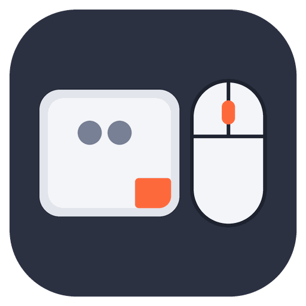

<div align="center">



# Trackpad & Mouse Tools

**Every trackpad and mouse setting, one keystroke away.**<br>
A [Raycast](https://raycast.com) extension that switches right-click modes, sets pointer speed and clicks mouse buttons from the keyboard – no System Settings, no logging out.

[](https://github.com/jnbp/raycast-trackpad-mouse-tools/releases/latest)


[](LICENSE)

[**Download the installer**](https://github.com/jnbp/raycast-trackpad-mouse-tools/releases/latest/download/install-trackpad-mouse-tools.zip) · [What it does](#what-it-does) · [Commands](#commands) · [FAQ](#faq)

</div>

---

## Why

Some days you want a two-finger right-click. Other days you rest a second finger on the trackpad and keep
opening context menus by accident, so you would rather click the bottom-right corner. macOS hides that choice
three levels deep in System Settings.

Trackpad & Mouse Tools puts it – and every other trackpad and mouse setting – behind a Raycast hotkey. It also
gives your keyboard real mouse buttons: middle-click a link to open it in a new tab, or hold the middle button to
orbit a model in a 3D app, all without a mouse.

## What it does

<table>
<tr>
<td width="50%" valign="top">

### 🖱️ Switch right-click in a second
**Toggle Secondary Click** flips between *two fingers* and a *corner* (bottom right or bottom left). Fixed
commands set one mode directly. Every change applies instantly and confirms itself with a small HUD.

</td>
<td width="50%" valign="top">

### ⚡ Set pointer speed by number
**Set Mouse Speed** and **Set Trackpad Speed** take a level from 1 to 10 right in the search bar. **Increase** and
**Decrease Mouse Speed** step it up or down – handy when you move between a desk mouse and the couch.

</td>
</tr>
<tr>
<td width="50%" valign="top">

### 🖲️ Mouse buttons on your keyboard
**Left**, **Right** and **Middle Click** click wherever the pointer is. The **Hold** commands keep a button pressed
until your next click, a few seconds, or until you run the command again – perfect for orbiting and panning in 3D
and design apps.

</td>
<td width="50%" valign="top">

### ⚙️ All settings in one list
**Trackpad & Mouse Settings** shows every option from System Settings, grouped like macOS: point & click, scroll
& zoom, gestures, mouse and dragging style. Search, toggle with `↵`, pick options with `⌘K`, reset with `⌘⇧⌫`.

</td>
</tr>
</table>

## Commands

| Command | What it does |
| --- | --- |
| **Toggle Secondary Click** | Two fingers ↔ corner (corner chosen in the command preferences) |
| **Secondary Click with Two Fingers / in Bottom Right Corner / in Bottom Left Corner** | Sets one mode directly |
| **Toggle Tap to Click** | Tap to click on or off |
| **Toggle Natural Scrolling** | Scroll direction on or off (macOS applies it to trackpad and mouse) |
| **Toggle Three Finger Drag** | Three finger drag on or off; swipes move to four fingers, like in macOS |
| **Set Mouse Speed / Set Trackpad Speed** | Pick a level from 1 to 10 |
| **Increase / Decrease Mouse Speed** | One step faster or slower |
| **Left Click / Right Click / Middle Click** | Click at the pointer |
| **Hold Left / Right / Middle Button** | Keep a button pressed (see [Holding a button](#holding-a-button)) |
| **Release Mouse Buttons** | Lets go of every button this extension holds |
| **Trackpad & Mouse Settings** | The full settings list |

> [!TIP]
> Give the commands you use most a hotkey: open Raycast, select the command, press `⌘K` → **Configure Command**.

### Everything in the settings list

| Section | Settings |
| --- | --- |
| Trackpad · Point & Click | Secondary click, tap to click, look up & data detectors, click pressure, tracking speed, force click |
| Trackpad · Scroll & Zoom | Natural scrolling, zoom in or out, smart zoom, rotate |
| Trackpad · More Gestures | Swipe between pages, full-screen apps, Mission Control, App Exposé, Notification Center, Show Desktop |
| Mouse | Tracking speed, scrolling speed, double-click speed, pointer acceleration, Magic Mouse secondary click |
| Accessibility | Dragging style: off, without drag lock, with drag lock, three finger drag |

### Holding a button

Raycast knows when a hotkey is pressed, not when it is released, so each **Hold** command has a **Release**
preference:

| Release | The button goes up |
| --- | --- |
| **After the Next Click** *(default)* | when you click the trackpad or mouse once (a left hold waits for a right click) |
| **After a Few Seconds** | after the number of seconds you set, 5 by default |
| **When I Run the Command Again** | when you press the hotkey a second time |

Running the command again always releases the button right away. Typical use: hotkey on **Hold Middle Button**,
pointer on the model, press the hotkey, move to orbit, click once to let go.

## Installation

### Option 1 – Installer (recommended)

1. Download **[install-trackpad-mouse-tools.zip](https://github.com/jnbp/raycast-trackpad-mouse-tools/releases/latest/download/install-trackpad-mouse-tools.zip)** and double-click it to unzip.
2. Double-click **install-trackpad-mouse-tools.command**.

The installer checks for Raycast and Node.js, downloads the latest release and imports the extension. **Run the
same file again to update** – it always fetches the newest release, keeps your hotkeys and preferences, and
keeps the previous version as a backup.

> [!NOTE]
> Downloaded scripts are not signed by Apple, so macOS may block the first double-click. Open **System Settings ›
> Privacy & Security** and click **Open Anyway**, or start it from Terminal, which is never blocked:
>
> ```bash
> bash ~/Downloads/install-trackpad-mouse-tools.command
> ```

### Option 2 – From source

```bash
git clone https://github.com/jnbp/raycast-trackpad-mouse-tools.git
cd raycast-trackpad-mouse-tools
npm install && npm run dev
```

**Requirements:** macOS, [Raycast](https://raycast.com) and Node.js 22 or newer. The installer sets up Node
through Homebrew if it is missing.

## How it works

The extension writes the same preferences System Settings writes – for the built-in trackpad, the Magic Trackpad
and the Magic Mouse – and asks macOS to reload them, so changes apply without logging out. Gestures handled by the
Dock (Mission Control, App Exposé, Show Desktop) restart the Dock for a moment.

The click commands post real mouse events through macOS' CoreGraphics, using the Accessibility permission Raycast
already has. A hold that ends after the next click or after a few seconds starts a small `osascript` process that
lets go of the button: it exits after the release click (at the latest after ten minutes) or after the chosen
number of seconds. Running the hold command again or **Release Mouse Buttons** stops it right away. No helper app.

## FAQ

<details>
<summary><b>System Settings still shows the old value.</b></summary>

System Settings reads its values when it opens. Close and reopen it to see the change.
</details>

<details>
<summary><b>A change did not take effect.</b></summary>

The extension tells you when macOS refuses the live reload. Log out and back in once and the setting is active.
</details>

<details>
<summary><b>A mouse button seems stuck.</b></summary>

Run **Release Mouse Buttons**. It lets go of every button held by the extension.
</details>

<details>
<summary><b>Can it do a middle click with a three finger tap, or remap mouse buttons?</b></summary>

Not on its own. Those need an app that runs in the background all the time and watches every input event, such as
[Mac Mouse Fix](https://macmousefix.com). A Raycast extension only runs while you use it, so it works alongside
those apps instead of replacing them.
</details>

<details>
<summary><b>Does it send any data anywhere?</b></summary>

No. Everything happens locally and the extension makes no network requests.
</details>

## License

[MIT](LICENSE) © jnbp
